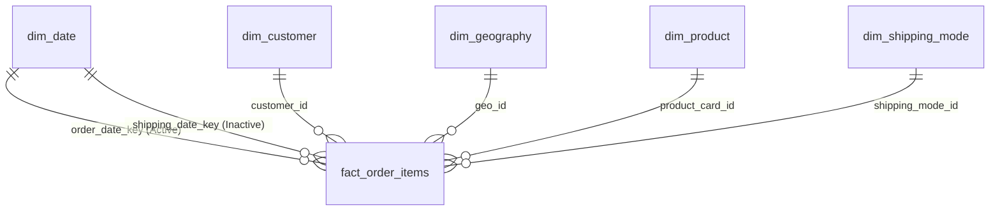

# SupplyX – Power BI Architecture & Dashboard Specification
*A non-technical, user-friendly supply chain analytics suite with full DAX library.*

---

## 1. Data Model Architecture (Star Schema)

The Power BI data model connects the central fact table to 5 normalized dimensions imported from SQLite (`data/supplyx.db`):



- **Cross-filter direction**: Single (`1` to `*`).
- **Date Relationship**:
  - `dim_date[date_key] 1 -> * fact_order_items[order_date_key]` (Active for order-date reporting).
  - `dim_date[date_key] 1 -> * fact_order_items[shipping_date_key]` (Inactive, activated via `USERELATIONSHIP` for transit duration analysis).

---

## 2. Production DAX Measure Library (16 Measures)

```dax
// ==============================================================================
// VOLUME & DEMAND MEASURES
// ==============================================================================

// Distinct customer orders (prevents line-item double counting)
[Total Orders] = 
DISTINCTCOUNT(fact_order_items[order_id])

// Total individual line items packed and shipped
[Total Line Items] = 
COUNTROWS(fact_order_items)

// Total product units demanded
[Total Units Shipped] = 
SUM(fact_order_items[order_item_quantity])

// Average items packed per order
[Avg Items Per Order] = 
DIVIDE([Total Line Items], [Total Orders], 0)


// ==============================================================================
// COMMERCIAL & REVENUE MEASURES
// ==============================================================================

// Gross catalog value before discounts
[Gross Catalog Sales] = 
SUM(fact_order_items[sales])

// Total promotional markdown absorbed
[Total Discounts Absorbed] = 
SUM(fact_order_items[order_item_discount])

// Net cash collected from customers
[Net Sales Revenue] = 
SUM(fact_order_items[order_item_total])

// Operating profit retained after product cost
[Operating Profit] = 
SUM(fact_order_items[order_profit_per_order])

// Percentage of net revenue converted to operating profit
[Operating Profit Margin %] = 
DIVIDE([Operating Profit], [Net Sales Revenue], 0)

// Average discount rate across catalog sales
[Avg Discount Rate %] = 
DIVIDE([Total Discounts Absorbed], [Gross Catalog Sales], 0)


// ==============================================================================
// FULFILLMENT & SLA PERFORMANCE MEASURES
// ==============================================================================

// Total shipments delivered after promised scheduled date
[Late Shipments Count] = 
CALCULATE(
    COUNTROWS(fact_order_items), 
    fact_order_items[late_delivery_risk] = 1
)

// Overall late delivery percentage
[Late Delivery Rate %] = 
DIVIDE([Late Shipments Count], [Total Line Items], 0)

// Orders arriving on or before promised delivery date
[On-Time Shipments Count] = 
CALCULATE(
    COUNTROWS(fact_order_items),
    fact_order_items[delivery_status] IN {"Shipping on time", "Advance shipping"}
)

// On-time fulfillment adherence
[On-Time Delivery Rate %] = 
DIVIDE([On-Time Shipments Count], [Total Line Items], 0)

// Percentage of shipments canceled prior to delivery
[Cancellation Rate %] = 
DIVIDE(
    CALCULATE(COUNTROWS(fact_order_items), fact_order_items[delivery_status] = "Shipping canceled"),
    [Total Line Items],
    0
)

// Actual transit days from order date to delivery
[Avg Real Shipping Days] = 
AVERAGE(fact_order_items[days_shipping_real])

// Promised transit days shown to customer at checkout
[Avg Scheduled Shipping Days] = 
AVERAGE(fact_order_items[days_shipping_scheduled])

// Days overdue beyond promised delivery window
[Delivery Delay Gap Days] = 
[Avg Real Shipping Days] - [Avg Scheduled Shipping Days]

// Number of line items sold at negative operating profit
[Loss-Making Line Items] = 
CALCULATE(
    COUNTROWS(fact_order_items), 
    fact_order_items[is_negative_profit] = 1
)

// Percentage of line items generating negative profit
[Loss-Making Order Rate %] = 
DIVIDE([Loss-Making Line Items], [Total Line Items], 0)
```

---

## 3. User-Friendly Dashboard Page Layouts

### Page 1: Operations Executive Overview
*Designed for C-suite and Operations Directors to monitor network health in 5 seconds.*
- **Top Header**: "SupplyX – Global Supply Chain Operations Overview" with plain-English date scope (Jan 2015 – Jan 2018).
- **Executive KPI Cards** (with status badges):
  - **Orders Handled**: `65,752` (Subtitle: 180,519 Line Items)
  - **Net Revenue**: `$33.05M` (Subtitle: $3.97M Profit | 12.0% Margin 🟢)
  - **On-Time Delivery Rate**: `40.88%` (Status Badge: 🔴 Action Required | Benchmark: >90%)
  - **Average Delivery Speed**: `3.50 Days` (Scheduled: 2.93 Days | Delay Gap: +0.57 Days ⚠️)
  - **Order Cancellation Rate**: `4.30%` (Status Badge: ⚠️ Monitor Lost Sales)
- **Visuals**:
  - *Left Bar Chart*: Net Revenue & Order Volume by Global Market (Europe, LATAM, Pacific Asia, USCA, Africa).
  - *Right Donut Chart*: Fulfillment Outcome Breakdown (Late: 54.8%, Early: 23.0%, On-Time: 17.8%, Canceled: 4.3%).
  - *Bottom Trend Line*: Monthly Net Sales and Order Items over 37 months.
- **Interactive Slicers**: Year, Global Market, Customer Segment, Shipping Mode.

### Page 2: Delivery & Shipping SLA Performance
*Designed for Logistics and Carrier Managers to diagnose delivery bottlenecks.*
- **Top Diagnostic Callout**: "Why is Late Delivery Rate 54.8%? First Class is scheduled for 1 day but takes 2 days; Standard Class is scheduled for 4 days."
- **Visuals**:
  - *Visual 1 (Grouped Bar + Line)*: Scheduled vs Actual Days by Shipping Mode with Late Rate % overlay (Figure 1).
  - *Visual 2 (Histogram)*: Shipping Delay Days Distribution (Peak at +1 day overdue).
  - *Visual 3 (Choropleth Map / Tree Map)*: Regional Late Delivery Rate across 23 global regions.
  - *Visual 4 (Table)*: Carrier Mode Scorecard: Total Shipments, Avg Real Days, Avg Scheduled Days, Delay Gap, Late %.

### Page 3: Commercial Demand & Product Performance
*Designed for Merchandising and Sales Leadership.*
- **Visuals**:
  - *Visual 1 (Scatter Plot)*: Product Category Volume vs Profit Margin %.
  - *Visual 2 (Top 10 Bar Chart)*: Highest Revenue Product Categories (Cleats, Men's Footwear, Women's Apparel).
  - *Visual 3 (Matrix Table)*: Department Performance (Orders, Net Sales, Profit, Late Rate %, Loss-Making Rate %).
  - *Visual 4 (Bar Chart)*: Customer Segment Breakdown (Consumer: 52%, Corporate: 30%, Home Office: 18%).

### Page 4: Exceptions & Problem Tracker
*Designed for Quality Control, Risk Management, and Customer Retention.*
- **Top Prominent Limitation Banner**:
  > [!NOTE]
  > **Data Disclosure**: Direct carrier freight billing/shipping costs are **not captured** in the source dataset. Reported financials reflect catalog sales, promotional discounts, and operating product profit.
- **Visuals**:
  - *Visual 1 (Bar Chart)*: Discount Tier vs Margin Collapse (Shows profit margin falling from 12.4% to negative when discounts exceed 20%).
  - *Visual 2 (Summary Cards)*: Loss-Making Order Items: `33,784` (18.7% of volume) | Lost Revenue from Cancellations: `$1.43M`.
  - *Visual 3 (Filterable Drill Table)*: High-Risk Order Exceptions with flags: `Order ID`, `Date`, `Product`, `Discount Rate`, `Profit`, `Delivery Status`, `Delay Days`.
  - *Visual 4 (Regional Risk Hotspots)*: Destination countries with highest cancellation and delay rates.

---

## 4. Drill-Through Architecture
- **Drill-Through Path**: `Market` -> `Order Region` -> `Order Country` -> `Category` -> `Order Item Detail`.
- **Tooltip Pages**: Hovering over any Region or Mode shows a mini-card displaying: Orders, Net Sales, Avg Real Days, and Late Rate %.
